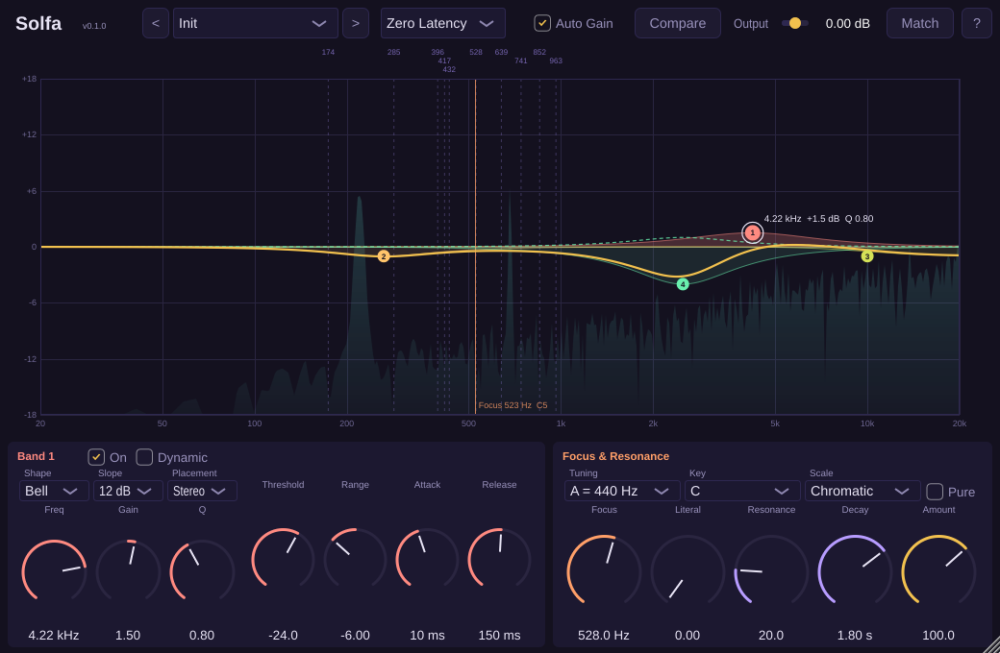

# Solfa

A parametric EQ whose presets are named after the solfeggio frequencies and 432 Hz tuning,
and designed from psychoacoustics research to shape the *feel* of a sound.

Solfa makes no health or therapeutic claims. The research behind its design, including
what the evidence does and doesn't support, is in [`docs/research/`](docs/research/).

## Status

**Phase 2 (EQ engine)**: bell, low/high shelf, low/high cut, tilt bands, an Amount
macro and output gain, with analog-matched filters (see [`docs/dsp-decisions.md`](docs/dsp-decisions.md)).

**Phase 3 (gain staging)**: Auto Gain keeps the loudness steady as you EQ, and Compare plays the
unprocessed sound at the same loudness so you can judge the tone, not the volume.

**Phase 4 (bands & shapes)**: 24 bands, notch and band-pass shapes, 6-96 dB/oct cut slopes, and
per-band Stereo / Left / Right / Mid / Side placement. Full plan: [`docs/roadmap.md`](docs/roadmap.md).

**Phase 5 (presets & Resonance)**: 10 factory presets named after the solfeggio / 432 Hz numbers,
a Focus frequency with Key Snap (A = 440 / 432 / 444, key, scale) or Pure, a Literal boost, and
Resonance: tuned resonators that ring at the Focus and its octaves with your music. Presets show
up in your DAW's preset list. Details: [`docs/presets.md`](docs/presets.md).

**Phase 7 (interface)**: Solfa's own UI: live analyser, EQ curve with draggable band nodes,
solfeggio markers and the Focus line, Spectrum Grab, band and Focus & Resonance panels, preset
browser and an "About the science" panel.



| In the display | Does |
|---|---|
| Drag a node | Frequency and gain |
| Mouse wheel on a node | Q |
| Double-click empty space / a node | Add a band / remove it |
| Right-click a node | Shape, slope, stereo placement, Dynamic, remove |
| Alt-click | Spectrum Grab: add a band on the nearest peak in the analyser |

**Phase 9 (EQ Match)**: load a reference track (or play one through Solfa), play your own
track, and Solfa fits normal bands that give yours the reference's tonal balance.


**Phase 8 (linear phase)**: a Phase selector (Zero Latency / Linear Phase / Linear Phase HD) for
mastering-style EQ without phase shift. Latency is reported to your DAW, which compensates.

**Phase 6 (dynamic EQ)**: any bell, shelf or tilt band can react to its own frequency region,
taming it (or lifting it) only when it gets loud, with Threshold, Range, Attack and Release.
There is no custom UI yet: the plugin shows a plain list of its parameters until Phase 5.

| Format | Platforms | DAWs |
|---|---|---|
| VST3 | macOS, Windows, Linux | FL Studio, Ableton Live, Cubase, Studio One, Reaper, Bitwig |
| AU | macOS | Logic Pro, GarageBand, Ableton Live, Studio One |
| AAX | macOS, Windows | Pro Tools (see below) |
| CLAP | macOS, Windows, Linux | Bitwig, Reaper, FL Studio |
| Standalone | all | none (runs on its own) |

## Building on your Mac

One-time setup:

```bash
xcode-select --install          # Apple's compilers
brew install cmake ninja        # needs Homebrew: https://brew.sh
git clone --recurse-submodules <this repo's URL>
cd solfa
```

Build (Debug is faster to compile; use Release when making music with it):

```bash
cmake -B Builds -G Ninja -DCMAKE_BUILD_TYPE=Release
cmake --build Builds --target Solfa_All Solfa_CLAP Tests
ctest --test-dir Builds --output-on-failure
```

The plugins are copied into `~/Library/Audio/Plug-Ins/` automatically after each build, so
rescan plugins in your DAW and Solfa appears under **Solfa Audio**.

Prefer Xcode? `cmake -B Xcode -G Xcode` then open `Xcode/Solfa.xcodeproj`.

### Pro Tools (AAX)

Retail Pro Tools only loads AAX plugins signed through Avid/PACE. To test without signing,
use the developer build of Pro Tools that Avid provides to registered AAX developers.
Apply for a free Avid developer account early, because approval can take weeks.

## CI

Every push builds all formats on macOS, Windows and Linux, runs the unit tests, runs
[pluginval](https://github.com/Tracktion/pluginval) at strictness 10, and runs Apple's `auval` on
the AU. Unsigned builds are attached to each run as downloadable zips.

Builds are **unsigned**. A plugin you download from CI to your Mac needs its quarantine
flag removed before it will load:

```bash
xattr -dr com.apple.quarantine ~/Library/Audio/Plug-Ins/VST3/Solfa.vst3
```

## Credits

Built with [JUCE](https://juce.com) 9 (Starter licence) and the
[Pamplejuce](https://github.com/sudara/pamplejuce) template (MIT, see `LICENSE-pamplejuce.txt`).
CLAP support via [clap-juce-extensions](https://github.com/free-audio/clap-juce-extensions).
