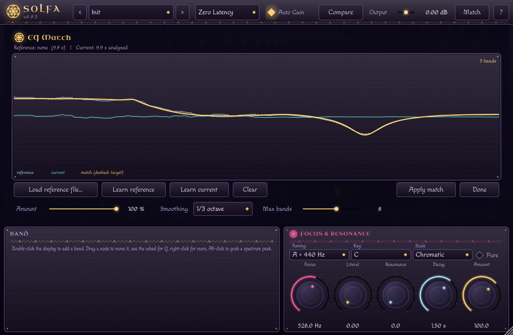

# Solfa

A 24-band parametric EQ whose presets are named after the solfeggio frequencies and 432 Hz
tuning, designed from psychoacoustics research to shape how a sound *feels*: warmer, clearer,
airier, more grounded. It adds tuned **Resonance** at a chosen Focus frequency, and has the
tools you'd expect from a modern pro EQ: dynamic bands, linear phase, EQ Match and Spectrum
Grab, in its own design.

Solfa makes no health or therapeutic claims. The research behind it, including what the
evidence does and doesn't support, is in [`docs/research/`](docs/research/).


**Status: 0.9.3 beta.** Every feature is built and tested automatically on macOS, Windows and
Linux, but it has not yet been tried by hand in real DAWs. Please work through
[`docs/testing-checklist.md`](docs/testing-checklist.md) and note anything odd.

## Formats

| Format | Platforms | DAWs |
|---|---|---|
| AU | macOS | Logic Pro, GarageBand, Ableton Live, Studio One |
| VST3 | macOS, Windows, Linux | FL Studio, Ableton Live, Cubase, Studio One, Reaper, Bitwig |
| AAX | macOS, Windows | Pro Tools (needs Avid signing, see below) |
| CLAP | macOS, Windows, Linux | Bitwig, Reaper, FL Studio |
| Standalone | all | none (runs on its own) |

## Using Solfa

### The display

| Do this | To |
|---|---|
| Drag a node | Change frequency and gain |
| Mouse wheel on a node | Change Q (width) |
| Double-click empty space | Add a band |
| Double-click a node | Remove it |
| Right-click a node | Shape, slope, stereo placement, Dynamic, remove |
| Alt-click | Spectrum Grab: add a band on the nearest peak in the analyser |

The glowing gold line is the overall EQ; each band is a lantern in its own colour, with its
curve shaded behind it. Violet light beams mark the solfeggio numbers (174 ... 963) and 432; the
rose-pink beam is the Focus. The scene behind (a jungle village at night under an indigo sky and a
faint aurora: moon, palms, stilt huts, a violet spirit fire and drifting aqua and violet lights) is drawn in code and stays dim so the curves remain easy to read.

### Bands

Up to 24 bands. Shapes: bell, low/high shelf, low/high cut (6-96 dB/oct), tilt, notch, band-pass.
Each band can work on Stereo, Left, Right, Mid or Side. Turn on **Dynamic** to make a band react to
its own frequency range: it moves towards **Range** as that range gets louder than **Threshold**
(negative Range tames, positive Range lifts), with **Attack** and **Release**.

### Presets

Ten factory presets plus Init (see [`docs/presets.md`](docs/presets.md)): Grounding 174,
Restore 285, Release 396, Change 417, Heart 528, Connect 639, Clarity 741, Intuition 852,
Crown 963 and Natural 432. They use broad, gentle moves on each number's octaves, where the ear
actually notices them. **Save preset...** in the preset menu stores your own in
`Documents/Solfa/Presets`; they appear under *My presets*.

### Focus & Resonance

- **Focus**: the preset's number (e.g. 528 Hz).
- **Key Snap**: pick a tuning reference (A = 440, 432 or 444), key and scale; the Focus moves to
  the nearest in-tune note (528 Hz becomes C5 = 523.25 Hz at A = 440, or 528.01 Hz at A = 444).
  **Pure** uses the exact number instead.
- **Resonance**: tuned resonators at the Focus and its octaves, driven by your music: the Focus
  rings with your track and goes quiet with it. **Decay** sets how long it rings.
- **Literal**: a narrow boost (up to 3 dB) exactly at the Focus.
- **Amount**: scales every band's boost or cut at once.

### Judging changes honestly

- **Auto Gain** (on by default) keeps the loudness steady as you EQ, so "louder" doesn't fool you
  into thinking "better".
- **Compare** plays the unprocessed sound at the same loudness as the processed sound.

### Phase

**Zero Latency** (default), **Linear Phase** (~43 ms latency) or **Linear Phase HD** (~171 ms, finer
bass detail). Linear phase avoids phase shift for mastering; your DAW compensates for the latency.
In linear-phase modes, Dynamic and Left/Right/Mid/Side bands act as static stereo bands.

### EQ Match

**Match** in the top bar: load a reference track (or play one through Solfa with *Learn
reference*), then play your own track with *Learn current*. Solfa fits up to 12 ordinary bands
that give your track the reference's tonal balance. Adjust Amount, Smoothing and Max bands, then
**Apply match**; the bands are yours to tweak.



## Building on your Mac

One-time setup:

```bash
xcode-select --install          # Apple's compilers
brew install cmake ninja        # needs Homebrew: https://brew.sh
git clone --recurse-submodules https://github.com/johnnybeatss/Solfa.git
cd Solfa
```

Build (Release is what you want for making music):

```bash
cmake -B Builds -G Ninja -DCMAKE_BUILD_TYPE=Release
cmake --build Builds --target Solfa_All Solfa_CLAP Tests
ctest --test-dir Builds --output-on-failure
```

The AU, VST3 and CLAP plugins are copied into `~/Library/Audio/Plug-Ins/` automatically. Rescan
plugins in your DAW and look for **Solfa** by **Solfa Audio**. Prefer Xcode?
`cmake -B Xcode -G Xcode` and open `Xcode/Solfa.xcodeproj`.

**Pro Tools (AAX):** builds land in `Builds/AAX-not-installed/`. Retail Pro Tools only loads AAX
plugins signed with Avid's (free) PACE tools. Register as an AAX developer
(developer.avid.com/aax), request a *Pro Tools Developer* build from devauth@avid.com to test
unsigned plugins, then request the signing tools from audiosdk@avid.com.

**Builds from CI** (the Actions tab on GitHub) are unsigned. On a Mac, clear the quarantine flag
before use: `xattr -dr com.apple.quarantine ~/Library/Audio/Plug-Ins/VST3/Solfa.vst3` (same for
the `.component` and `.clap`).

## Documentation

- [`docs/research/report.md`](docs/research/report.md): the research behind Solfa
- [`docs/dsp-decisions.md`](docs/dsp-decisions.md): how the DSP works, with measurements
- [`docs/presets.md`](docs/presets.md): every factory preset's settings
- [`docs/roadmap.md`](docs/roadmap.md): build phases
- [`docs/testing-checklist.md`](docs/testing-checklist.md): manual DAW testing
- [`CHANGELOG.md`](CHANGELOG.md)

## Credits and licences

Built with [JUCE](https://juce.com) 9 and the [Pamplejuce](https://github.com/sudara/pamplejuce)
template (MIT, see `LICENSE-pamplejuce.txt`); CLAP support via
[clap-juce-extensions](https://github.com/free-audio/clap-juce-extensions). JUCE is dual-licensed
(AGPLv3 or a commercial licence); Solfa currently relies on JUCE's free Starter tier, and a paid
JUCE licence may be required if Solfa is ever sold or earns over the Starter limit. Check
[juce.com](https://juce.com/get-juce) before distributing. "VST" is a Steinberg trademark and is
not used in the product name.

Fonts, compiled into the plugin: [Uncial Antiqua](https://fonts.google.com/specimen/Uncial+Antiqua)
by Astigmatic (headings and logo) and [Macondo](https://fonts.google.com/specimen/Macondo) by John
Vargas Beltrán (all other text), both under the SIL Open Font License 1.1. The licence texts are in
`assets/fonts/`; ship them with any installer or download.
